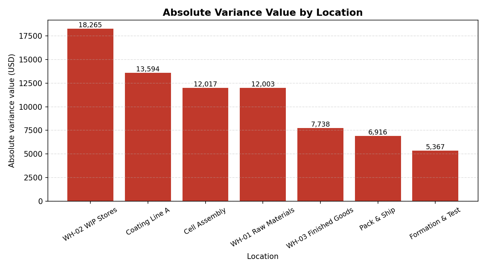
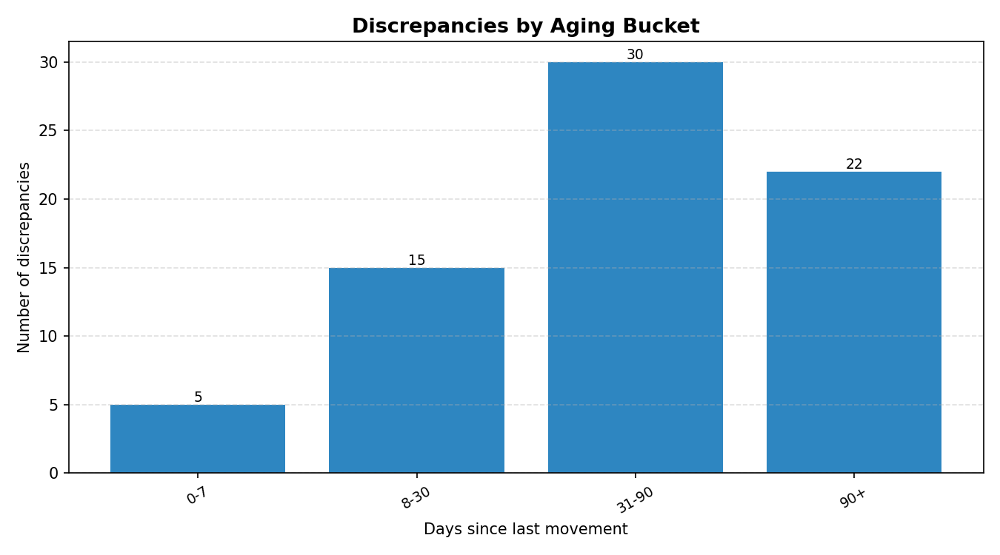
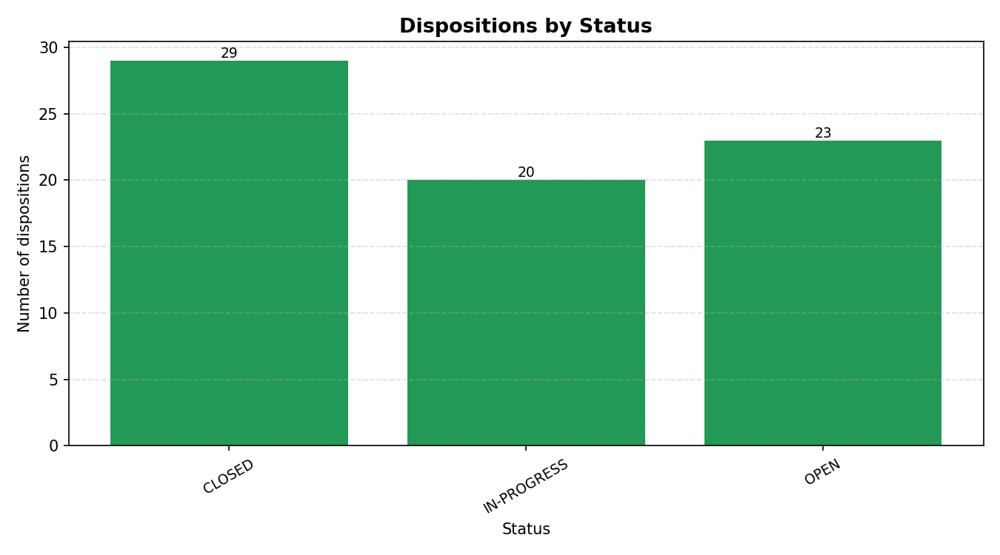

# Virtual Inventory Reconciliation Report

**As of:** 2026-11-11  |  **Records reconciled:** 600  |  **Locations:** 7  (4 production areas, 3 warehouses)

> All data in this report is synthetic, generated with a fixed seed for reproducibility. No real Tesla data is used.

## Executive Summary

- **Count accuracy:** 88.0% (528 of 600 records matched exactly).
- **Discrepancies found:** 72 (12.0% of records).
- **Total absolute variance value:** $75,900.48 on $3,190,686.27 of MES inventory value (2.38%).
- **Net variance value:** $-27,766.32 (negative = net short).
- **Open / in-progress dispositions past due:** 11 items, $15,628.96 of value.

## Discrepancies by Type

| Variance type | Count | Absolute value (USD) | Share of value |
|---|---:|---:|---:|
| OVER | 13 | $4,370.87 | 5.8% |
| SHORT | 49 | $27,107.69 | 35.7% |
| UNACCOUNTED | 10 | $44,421.92 | 58.5% |

## Variance by Location

| Location | Absolute variance value (USD) | Share |
|---|---:|---:|
| WH-02 WIP Stores | $18,265.21 | 24.1% |
| Coating Line A | $13,594.43 | 17.9% |
| Cell Assembly | $12,016.87 | 15.8% |
| WH-01 Raw Materials | $12,003.26 | 15.8% |
| WH-03 Finished Goods | $7,737.78 | 10.2% |
| Pack & Ship | $6,915.63 | 9.1% |
| Formation & Test | $5,367.30 | 7.1% |

## Aging of Discrepancies

| Aging bucket | Count | Absolute value (USD) |
|---|---:|---:|
| 0-7 days | 5 | $710.03 |
| 8-30 days | 15 | $23,725.69 |
| 31-90 days | 30 | $32,756.99 |
| 90+ days | 22 | $18,707.77 |

52 discrepancies (72.2%) are over 30 days old and need escalation.

## Disposition Status

| Status | Count |
|---|---:|
| CLOSED | 29 |
| IN-PROGRESS | 20 |
| OPEN | 23 |

## Disposition Mix

| Disposition | Count |
|---|---:|
| WRITE-OFF | 42 |
| QUARANTINE | 13 |
| RETURN-TO-STOCK | 9 |
| REWORK | 8 |

## Count Accuracy by ABC Class

| ABC class | Records | Records with variance | Count accuracy |
|---|---:|---:|---:|
| A | 279 | 32 | 88.5% |
| B | 154 | 20 | 87.0% |
| C | 167 | 20 | 88.0% |

Class A parts carry the most annual usage value and are counted first in the cycle-count rotation; class C parts are counted least often.

## Top 10 Discrepancies by Value

| Part | Location | Type | Variance qty | Abs value (USD) | Aging | Disposition | Owner | Status |
|---|---|---|---:|---:|---|---|---|---|
| NCM-ANO-1001 | WH-02 WIP Stores | UNACCOUNTED | 785 | $10,997.85 | 8-30 | WRITE-OFF | K. Brooks | OPEN |
| NCM-FOL-1586 | WH-01 Raw Materials | UNACCOUNTED | 832 | $6,373.12 | 31-90 | WRITE-OFF | K. Brooks | CLOSED |
| NCM-CON-1382 | Coating Line A | UNACCOUNTED | -692 | $6,061.92 | 31-90 | WRITE-OFF | S. Okafor | CLOSED |
| NCM-TST-1373 | Cell Assembly | UNACCOUNTED | -273 | $5,894.07 | 31-90 | WRITE-OFF | M. Chen | IN-PROGRESS |
| NCM-FOL-1265 | Coating Line A | UNACCOUNTED | -501 | $4,103.19 | 90+ | QUARANTINE | R. Patel | CLOSED |
| NCM-CON-1243 | WH-01 Raw Materials | UNACCOUNTED | -967 | $3,490.87 | 8-30 | WRITE-OFF | K. Brooks | IN-PROGRESS |
| NCM-TST-1553 | Pack & Ship | UNACCOUNTED | -189 | $3,126.06 | 90+ | QUARANTINE | J. Alvarez | IN-PROGRESS |
| NCM-CAT-1393 | WH-02 WIP Stores | SHORT | -144 | $2,963.52 | 31-90 | QUARANTINE | R. Patel | OPEN |
| NCM-PKG-1280 | WH-02 WIP Stores | SHORT | -373 | $2,133.56 | 90+ | QUARANTINE | T. Nguyen | CLOSED |
| NCM-TST-1555 | Pack & Ship | UNACCOUNTED | -120 | $2,049.60 | 90+ | QUARANTINE | T. Nguyen | CLOSED |

## Recommended Actions

1. Escalate the 11 past-due open dispositions to the production-control lead this week.
2. Physically recount the top 10 discrepancies above before confirming any write-off.
3. Investigate the highest-variance location for a systemic MES transaction or scanning issue (root cause, not just correction).
4. Tighten cycle-count frequency for class A parts, which carry the most value at risk.

## Files

- `reconciliation_summary.csv` — one row per discrepancy, with disposition, owner, due date and status.
- `variance_by_location.png`, `aging_buckets.png`, `disposition_status.png` — charts for this report.
- `../inventory.db` — SQLite database; see `../queries.sql` for the standard analysis queries.
